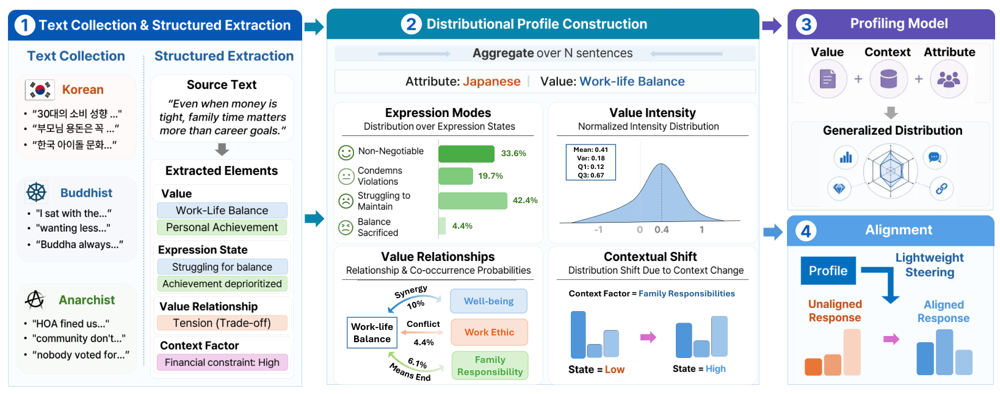
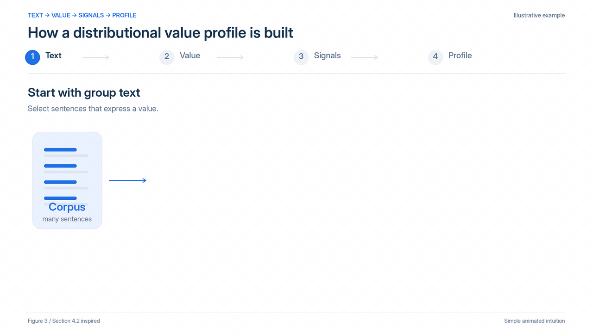

# Distributional value profiling

Code for building and exploring distributional value profiles. Profiles describe
how values are expressed, their intensity, and their relationships across groups
and contexts.

Use the provided profiles or build your own from prepared text. You can choose
the models, catalogs, and processing settings.



The paper's framework. This release includes data processing, annotation, and
profile construction. Training and steering code are coming soon.

## Project page

The [project page](docs/index.html) introduces the paper and its findings.
The hosted page is coming soon. See the [site guide](docs/README.md) to preview it locally.

## What is included

| Component | Location / availability |
| --- | --- |
| Data preparation, annotation, and profile construction | Code in this repository; see the [workflow guide](docs/workflow.md) |
| Example profiles | [Bundled examples](examples/released_profiles/README.md), about **0.15 MiB** |
| Full aggregate profiles | Coming soon on Hugging Face; about **779 MiB compressed** |
| Profile download and selection | [`profile_data.organize`](profile_data/organize.py); see the [precomputed-profile guide](docs/precomputed_profiles.md) |
| Constructed value and context catalogs | [`resources/original/`](resources/original/README.md) |

The full dataset contains eight profile families across 24 source groups.
Coverage varies by family; the manifest lists the available files and values.
The examples cover all eight families across seven CulturaX language groups.
They show the file formats and are not a representative sample or benchmark split.

Only aggregate profiles are included. Source texts, sentence-level annotations,
activation arrays, and model weights are excluded.

## Use precomputed profiles

Run commands from the repository root. Local selection needs only Python 3.10+;
it does not require a model or GPU.

### Try the bundled examples

List available families and groups:

```bash
python -m profile_data.organize \
  --source-dir examples/released_profiles --list
```

Select a categorical profile with at least 500 observations:

```bash
python -m profile_data.organize \
  --source-dir examples/released_profiles \
  --family base --group culturax_ko_cleaned --value fairness \
  --min-support base=500 \
  --output-dir outputs/profile_examples
```

The profile is saved to `outputs/profile_examples/data/base/culturax_ko_cleaned.jsonl`,
with a manifest recording the selection and file hashes. Choose a new output
directory for each run; existing directories are not overwritten.

### Use the full bundle

The full dataset's public release on Hugging Face is coming soon. If you already
have a local bundle, pass the directory containing `manifest.json` to `--source-dir`.
The same commands work with the examples and full dataset.

The organizer checks file hashes before selecting profiles. Repeat `--family`,
`--group`, or `--value` to select several names. Support thresholds use different
counts for each family, and filtering keeps the stored statistics unchanged.
See the [profile guide](docs/precomputed_profiles.md) for schemas, support fields,
and download options. Files use gzip-compressed JSONL, CSV, and JSON formats.

## Build profiles from your own data

<details>
<summary>Watch the profile-construction walkthrough (15 seconds)</summary>



Illustrative walkthrough with example sentences, labels, scores, and profiles.
These are not measured results or actual annotation outputs.

</details>

Use Python 3.10+ and a POSIX system with Bash. Install the processing dependencies:

```bash
python -m pip install -r requirements.txt
```

Optional continuous-profile plots additionally require `matplotlib`
(`python -m pip install matplotlib`).

For annotation and activation scoring, install the model dependencies in a
CUDA environment that supports your models:

```bash
python -m pip install -r requirements-inference.txt
```

The pipeline selects expressive text, extracts values, annotates expression,
relations and context, scores intensity from activations, and builds profiles.
You can run stages separately using existing annotations or vectors in the
documented formats.

| Stage | Location |
| --- | --- |
| Text preparation and expressive selection | `processing/` |
| Value extraction, mapping, and contrastive examples | `value_item_parser/` |
| Expression, relation, and context annotation | `intensity_parser/`, `relation_parser/`, `context_parser/` |
| Activations, value vectors, and projection scores | `activation_parser/` |
| Base distributions | `profile_constructor/` |
| Context effects | `context_parser/context_effect_*.py` |
| Relation distributions and profile assembly | `value_profiler/` |

Follow the [workflow guide](docs/workflow.md) for input formats, commands, and
settings. Scripts accept `--help`; shell launchers also accept `--dry-run` to
show commands without loading models or writing outputs.

Annotation uses local chat models through vLLM. Intensity scoring uses Hugging
Face causal models that expose hidden states. Check a small annotation sample
before processing a full corpus. Launchers check input alignment and protect
existing outputs; interrupted runs do not resume automatically.

## Checks

Run the tests and a synthetic CPU example:

```bash
python -m unittest discover -s tests -v
python examples/profiles/run_smoke.py --out_dir outputs/profile_smoke
```

These checks use synthetic inputs and model/download test doubles. They do not
download models. The bundled profile examples contain real aggregate records.

## Coming soon

Training and steering code, plus source-specific download instructions, are
coming soon. For now, supply prepared data.

## Data and licenses

Put local inputs in `data/` and generated files in `outputs/`; both are ignored
by Git. Profiles describe value expression in the selected corpora, rather than
population beliefs. Support counts do not measure independent people or guarantee
annotation quality or privacy.

Software and usage documentation use [MIT](LICENSE). Profiles and constructed
catalogs use [CC BY 4.0](LICENSE-DATA) for our contributions. Paper figures and
the animation retain their existing rights. Source-corpus and third-party terms
still apply; see [DATA.md](DATA.md) and [third-party notices](THIRD_PARTY_NOTICES.md).
